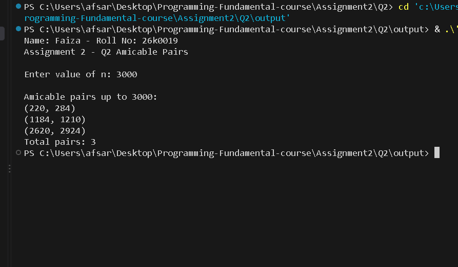

# Q2 - Amicable Pairs

**Name:** Faiza | **Roll No:** 26k0019
**Course:** Programming Fundamentals | **Assignment 2**

### 1. Question PDF
Full question PDF is here:

[📄 Click to Open - Qno 2.pdf](./Qno%202.pdf)

### 2. Program Output Screenshot
Here is the program output, visible directly in README:



If image not loading from root, check output folder:


### 3. How to Compile & Run
```bash
gcc q2.c -o q2 -lm
./q2
# Enter n = 3000
