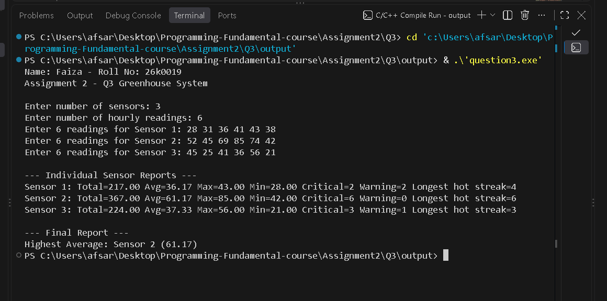

# Q3 - Greenhouse Temperature Monitoring System

**Name:** Faiza | **Roll No:** 26k0019
**Course:** Programming Fundamentals | **Assignment 2**

### 1. Question PDF
Full question PDF:

[📄 Click to Open - Qno3.pdf](./Qno3.pdf)

### 2. Program Output Screenshot
Output directly visible in README:



### 3. How to Compile & Run
```bash
gcc question3.c -o question3
./question3
