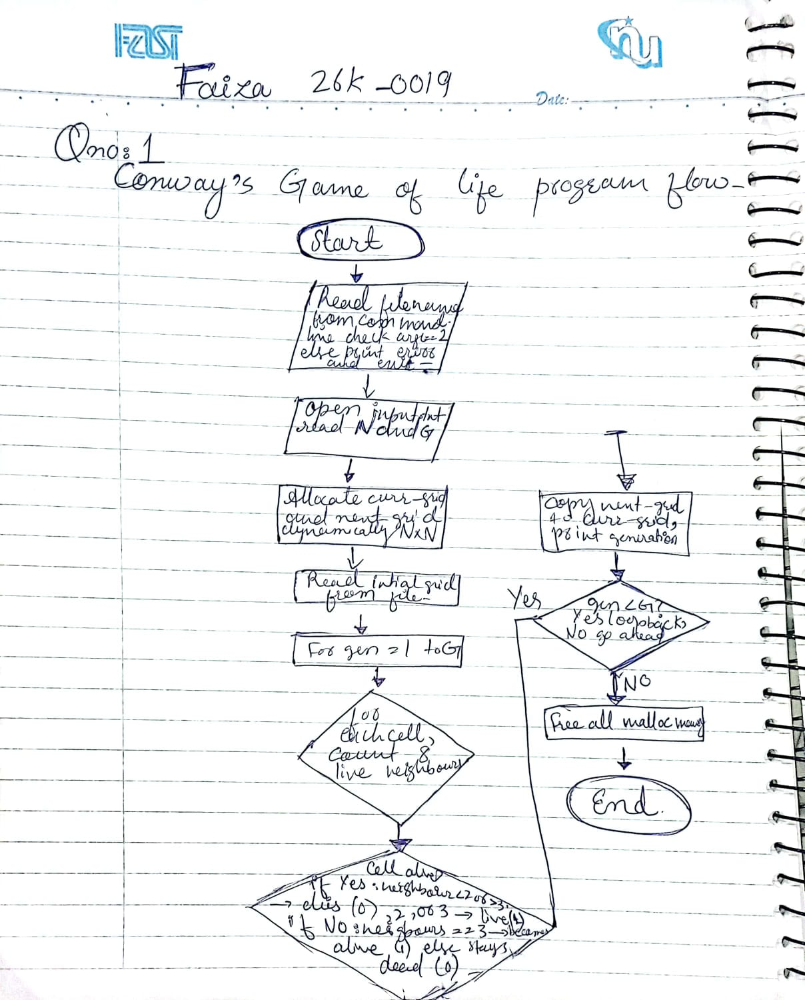
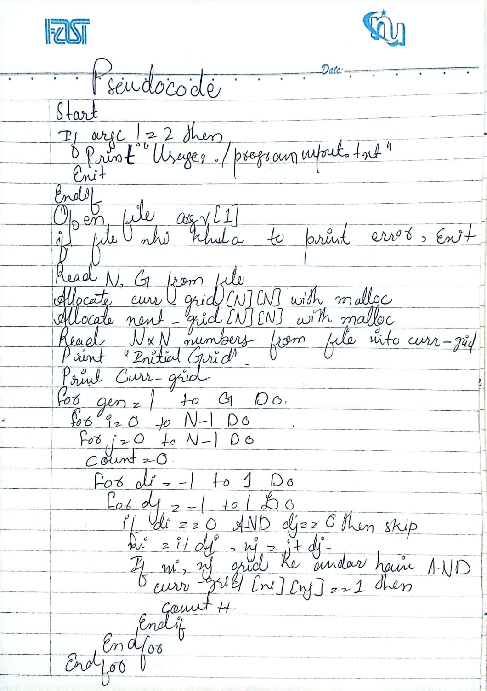
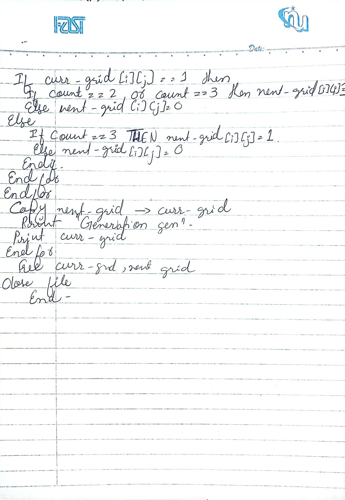
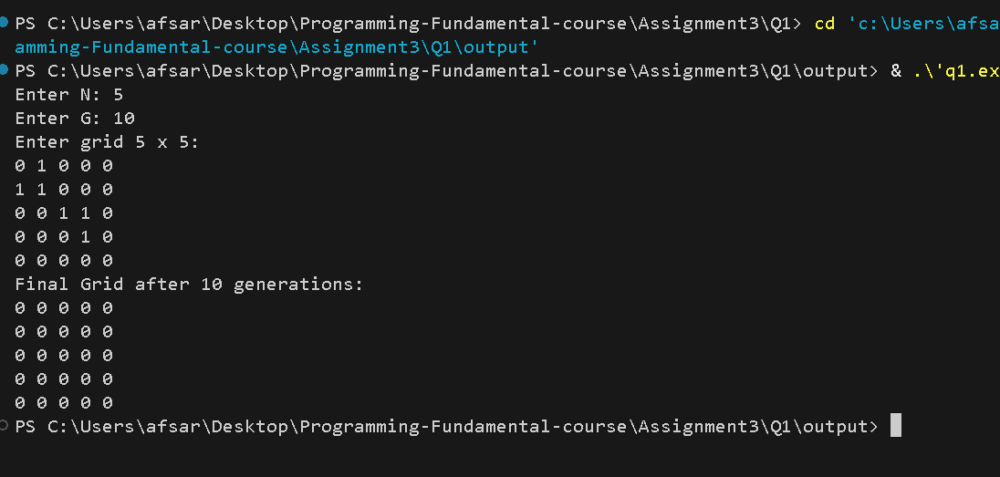

# Assignment 3 - Q1

## Description
This question is about finding the largest and second largest numbers from an array and checking if the largest number is divisible by the second largest number.

## Files in this Folder

### Flowchart

### Pseudocode

### Output

ss