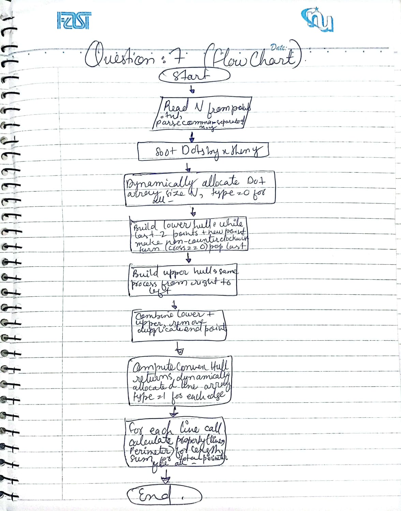
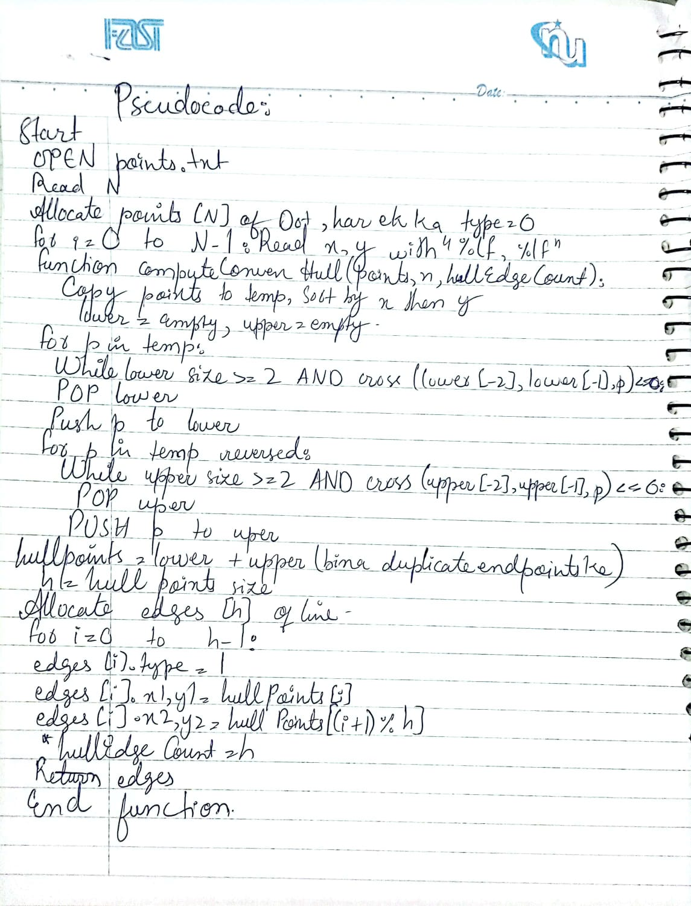
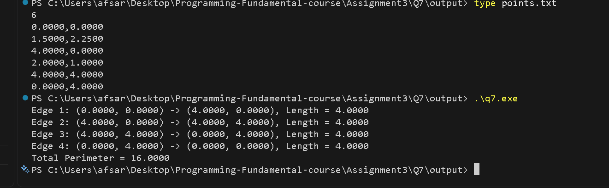
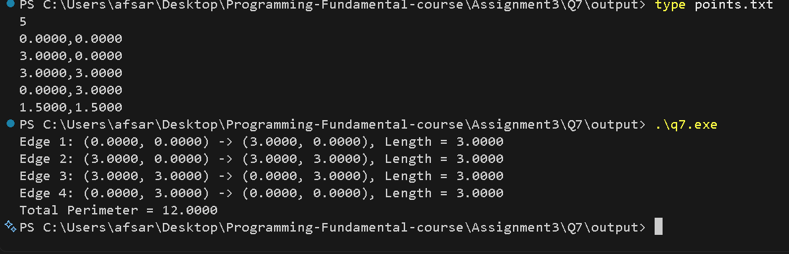

# Assignment 3 - Q7

## Description
Solution for Question 7 of Assignment 3 - Programming Fundamentals.
This program reads points from `points.txt` and calculates the perimeter of the polygon.

## Files in this Folder

### Flowchart

### Pseudocode

### Input File
[points.txt](points.txt)

### Output

